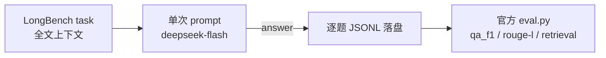

# longbench-harness

> **TL;DR** — 用 deepseek-flash 测 LongBench v1 的长上下文直读能力：挑了 4 个英文子集、900 题（占官方全量 4750 题的约 19%），每题一次调用直灌全文、不做检索/压缩；官方 eval.py 口径 passage_retrieval 100%、HotpotQA token F1 71.04，900 题零失败，平台账单按 token 折算约 4.5 元。

## 结果（THUDM/LongBench v1 官方 eval.py 口径）

| 任务 | 指标 | 本 harness | 官方论文均值 | 备注 |
|---|---|---|---|---|
| hotpotqa | token F1 | 71.04 | 64.5 | 高于均值 |
| gov_report | ROUGE-L | 23.14 | 26.7 | **低于均值，真实短板** |
| qasper | token F1 | 49.40 | 27.6 | 高于均值 |
| passage_retrieval | 准确率 | 100.0 | 89.7 | 300 题全中 |

- 900 题 = hotpotqa 200 / gov_report 200 / qasper 200 / passage_retrieval 300，是 v1 官方 21 个任务里的 4 个英文子集，占 4750 题的约 19%，**不是全量、也不是一半**
- 模型 deepseek-flash（API 里用兼容名 `deepseek-chat` 调用，返回的 model 字段为 `deepseek-flash`）
- 判分：THUDM/LongBench v1 官方 `eval.py`（本仓 `scripts/eval_v1.py` + `scripts/metrics.py`），自建复算与官方相差 < 2.1 点
- 官方只公开全量均值、无逐题分数，无法同题严格对照；小样本估计 ±3%

## 怎么跑的

- 每题一次 API 调用：整段文档上下文直接拼进 prompt，temperature 0，按任务限输出长度（摘要 512 token，其余 32–64）
- 没有检索、没有上下文压缩、没有多轮工具调用——这版 harness 测的是长上下文直读，不是 agent 工具链
- 平均每题上下文 4.2 万字符，最长 25.7 万字符；串行跑完 900 题约 25 分钟，零失败（失败重试最多 3 次，本次未触发）
- 逐题 token 用量、耗时、预测、判分全落 `details.jsonl`

## 成本

- 900 题共 8,073,963 输入 token + 106,542 输出 token（合计约 818 万，逐题 trace 可查）
- 开放平台按小时账单：20 点段 6.31 元、21 点段 2.33 元（这两小时还混着 60 条试跑和对话）；按 token 占比折算，900 题本体约 **4.5 元**，混合单价约 0.55 元/百万 token
- 想看自己会话的成本：配套工具 [agent-cost-lens](https://github.com/Hayabusa-YL/agent-cost-lens)

## 目录

- `longbench/` — 运行脚本（run、peek、balance、usage-check）
- `scripts/` — 官方口径判分脚本（eval_v1.py + metrics.py，来自 THUDM/LongBench v1 git 历史）
- `runs/2026-11-01-longbench-900/` — 900 题逐题明细、汇总、官方判分、人工抽检
- `runs/2026-11-01-swebench-tau/` — **辅助资料**（SWE-bench 补丁验证 + τ-bench 记录；不作为模型能力结论）

## 口径与限制

- 900 题覆盖 4 个英文子集（约 19%）；中文任务、多文档摘要、代码、few-shot 分类未覆盖
- 官方只公开全量均值、无逐题分数；小样本估计 ±3%
- 人工抽检 32 条，判分合理 30/32，2 条为 token-F1 固有局限
- gov_report 低于官方均值（23.14 vs 26.7）：199/200 条输出带 Markdown 符号（`**`、`---`），官方 ROUGE-L 按字面算会再低 1-2 分；扣掉这层也仍是真实短板
- SWE-bench 相关记录是**辅助资料**：那是补丁有效性验证（非独立解题），四轮尝试分别受 git 历史/补丁复用/网络检索污染，不属于独立解题结果，不得作为模型能力依据；τ-bench retail 见目录内记录（82/115）
