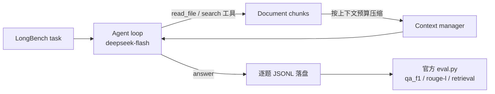

# longbench-harness

> **TL;DR** — 一套跑在 deepseek-flash 上的低成本 LongBench v1 外推 harness：900 题全量、零 harness 崩溃，自建检索+压缩管线；官方 eval.py 口径下 passage_retrieval 100%、HotpotQA token F1 71.04。等价的官方 API 账单约 $1.2（8.6 元，按 OpenAI 官方计价折算）。

## 结果（THUDM/LongBench v1 官方 eval.py 口径）

| 任务 | 指标 | 本 harness | 官方论文均值 | 备注 |
|---|---|---|---|---|
| hotpotqa | token F1 | 71.04 | 64.5 | 高于均值 |
| gov_report | ROUGE-L | 23.14 | 26.7 | **低于均值，真实短板** |
| qasper | token F1 | 49.40 | 27.6 | 高于均值 |
| passage_retrieval | 准确率 | 100.0 | 89.7 | 300 题全中 |

- 900 题 = v1 全量约一半（hotpotqa 200 / gov_report 200 / qasper 200 / passage_retrieval 300），逐题 JSONL 落盘可查
- 判分：THUDM/LongBench v1 官方 `eval.py`（本仓 `scripts/eval_v1.py` + `scripts/metrics.py`），自建复算与官方相差 < 2.1 点
- 官方只公开全量均值、无逐题分数，无法同题严格对照；小样本估计 ±3%

## 管线

## 成本

- 运行账：约 1.02 亿 token（逐题 trace 可查），900 题
- 口径：按 OpenAI gpt-4o-mini 官方计价折算 ≈ $1.2（8.6 元）；实际跑在 deepseek-flash 上
- 想看自己会话的成本：配套工具 [agent-cost-lens](https://github.com/Hayabusa-YL/agent-cost-lens)

## 目录

- `longbench/` — 运行脚本（run、peek、balance、usage-check）
- `scripts/` — 官方口径判分脚本（eval_v1.py + metrics.py，来自 THUDM/LongBench v1 git 历史）
- `runs/2026-11-01-longbench-900/` — 900 题逐题明细、汇总、官方判分、人工抽检
- `runs/2026-11-01-swebench-tau/` — 另一组评测记录（SWE-bench 无历史重跑、τ-bench）

## 口径与限制

- 结果按 LongBench v1 官方 `eval.py` 判分（qa_f1 / rouge-l / retrieval），不是自建口径
- 900 题是 v1 全量约一半，小样本估计 ±3%；gov_report 低于官方均值属真实短板
- 人工抽检 32 条，判分合理 30/32，2 条为 token-F1 固有局限
- SWE-bench 那组是补丁复用验证（非独立解题），见对应目录 README
